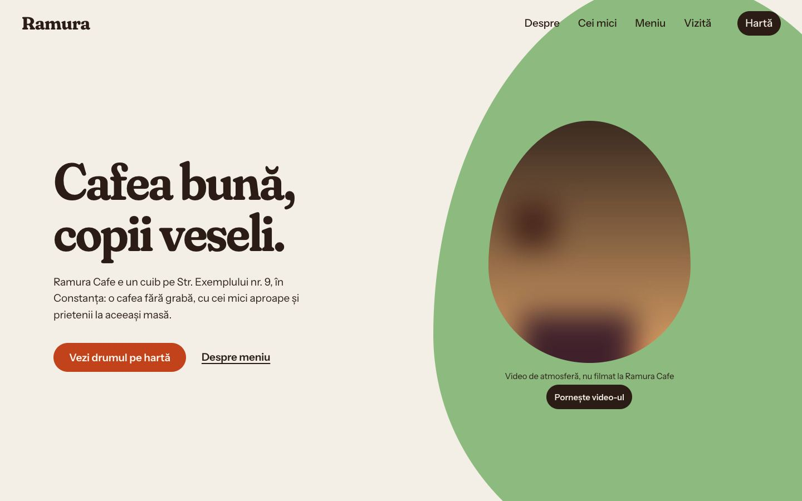
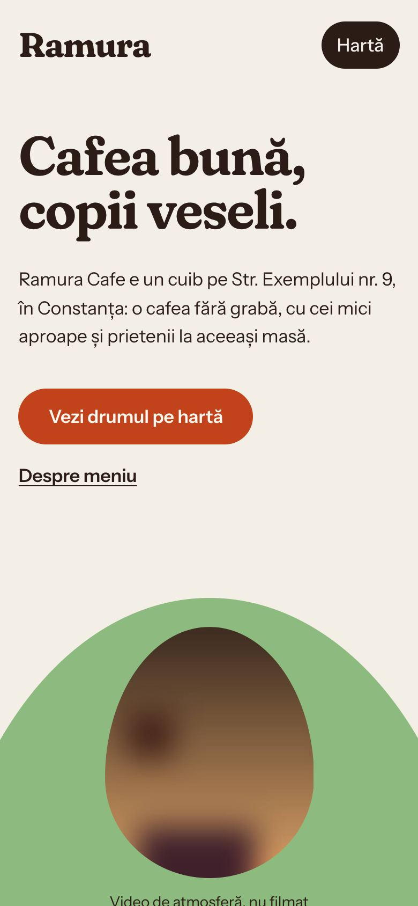
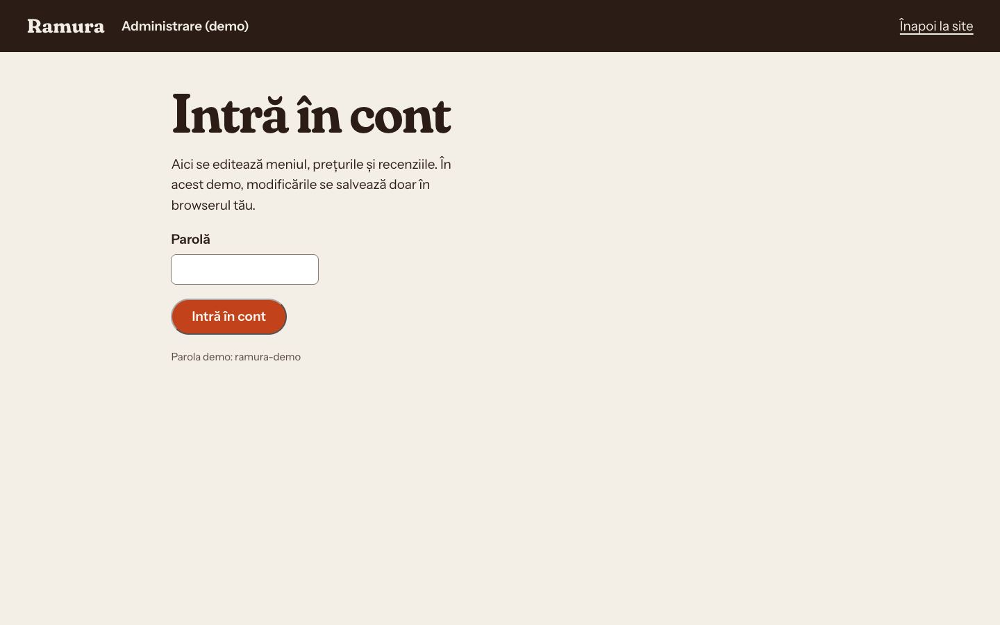
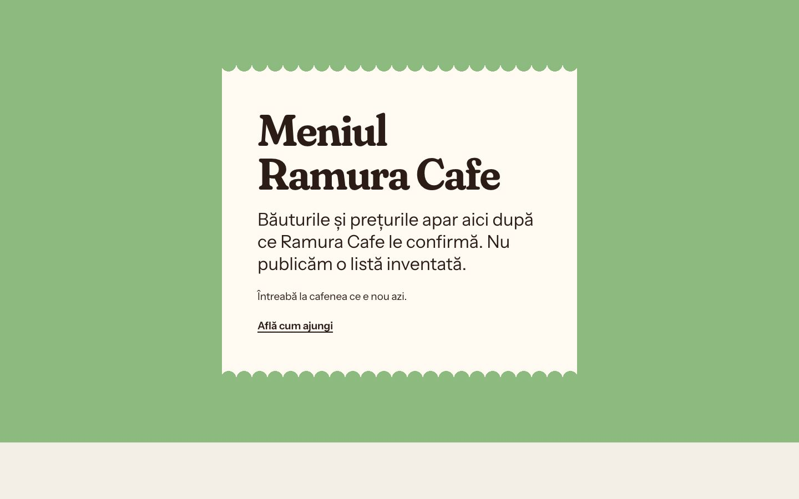

# Ramura Cafe



Site pentru o cafenea prietenoasă cu familiile, cu panou de administrare demo (React + Vite).

> Proiect demonstrativ. Firma, adresa, telefoanele, emailurile și recenziile sunt fictive. Orice asemănare cu o firmă reală este întâmplătoare.

## Capturi de ecran

| Prima pagină, telefon | Panou de administrare (demo) | Meniul |
|---|---|---|
|  |  |  |

## Tehnologii

React și TypeScript, cu Vite și Motion pentru animații.

## Decizii tehnice

- Conținutul (texte, imagini, teme) stă într-un singur fișier, `src/content.ts`, separat de componente.
- Meniul și recenziile se editează dintr-un panou demo (`#admin`), cu datele salvate în localStorage. Nu se publică un meniu inventat.
- Animațiile Motion respectă „prefers-reduced-motion”.
- Videoclipul din hero are licență CC0 și poate fi oprit din buton.
- Accesibilitate: link „Sari la conținut”, mesaje anunțate cititoarelor de ecran (aria-live), focus vizibil la navigarea cu tastatura.
- Animațiile se reduc sau se opresc pentru cine a setat „reducerea mișcării” în sistem (`prefers-reduced-motion`).
- Imaginile din afara ecranului se încarcă abia când e nevoie de ele (`loading="lazy"`).

## Rulare

```bash
cd site
npm install
npm run dev
```

## Cum a fost realizat

Proiectul a fost conceput și dezvoltat de Cristian Lucaci. În procesul de creație am folosit și instrumente de inteligență artificială, ca sprijin la scrierea codului, la texte și la verificări. Deciziile de design, alegerile tehnice și forma finală îmi aparțin.

## Licență

Codul este publicat sub licența [MIT](LICENSE), © 2026 Cristian Lucaci.

Resursele terțe incluse (fonturi, biblioteci, fotografii sau modele 3D cu licență liberă) își păstrează licențele proprii, menționate lângă fișiere sau în pagină. Imaginile fără sursă menționată sunt grafică generată pentru acest proiect.
